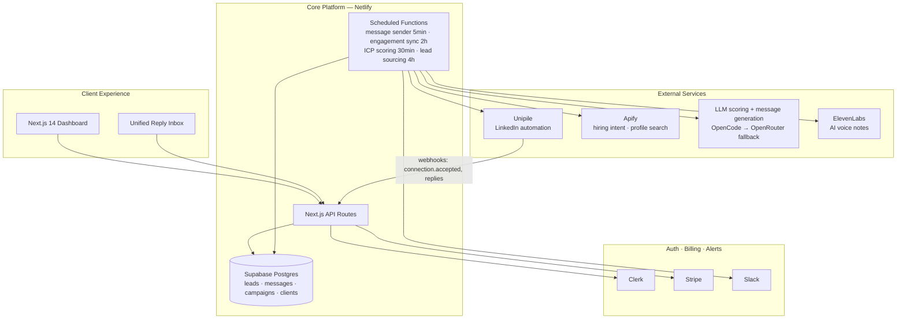
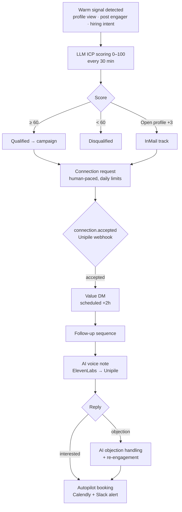

<h1 align="center">
  
</h1>

  <b>I build and deploy AI-powered software directly with customers — from discovery to production.</b> 
  US Citizen · Washington DC-Baltimore Area · Remote · 2-Week Notice · Open to Full-Time & Contract

  
  
  
  
  

  
  
  

---

## ✨ TL;DR

I'm a **Forward Deployed Engineer**: I embed with customers, map their workflows, and ship production software that solves them. 7 years shipping **TypeScript/React/Next.js**, **Python/FastAPI/Node.js**, and **PostgreSQL** — from fintech (SoFi) to government/defense (General Dynamics IT). Now at CalendarFuel, I build and run the **LinkedIn outreach platform** end-to-end — warm signal detection, LLM ICP scoring, personalized sequences, and autopilot booking — for real customer environments.

**Currently in production:** ~50 customers and campaigns across 10 companies · workflows processing up to **500K prospects/records per month** · ~1 week faster time-to-close through automated research, personalized outreach, and sales intelligence.

I ship with **Cursor**, **Claude Code & Codex**, and **GitHub Copilot** daily — using **GPT-4o**, **GPT-4o-mini**, **Claude 3.5 Sonnet**, and **Claude 3 Opus** to accelerate architecture, not replace judgment. Every AI system I ship comes with eval gates and a rollback path.

---

## 💼 Experience

### Forward Deployed Engineer — CalendarFuel
*Jan 2025 – Present*

- Build and deploy production AI-powered software for a growing B2B SaaS company, working directly across engineering, product, sales, customers, and internal stakeholders.
- Translate customer workflows and business requirements into shipped features, prototypes, integrations, and production-ready solutions.
- Design integration architecture and data flows across CRM, enrichment, sequencing, communication, and internal systems — REST APIs, webhooks, async workflows, structured reporting.
- Build LLM-powered workflows, agents, dynamic personalization, and intelligent automation with TypeScript, React, Next.js, Python, and FastAPI.
- Support ~50 customers and campaigns across 10 companies, including client teams of 5–10 running active campaigns.
- Operate 20–30 active LinkedIn profiles for internal sales teams; support workflows processing up to 500,000 prospects/records per month.
- Cut time-to-close by ~1 week via faster data flow, personalized outreach, automated follow-up, and clearer sales intelligence.
- Own production troubleshooting, AI output evaluation, and customer feedback loops across the full SDLC.

### Software Engineer — SoFi
*Jan 2024 – Dec 2024 · Remote*

- Built Python (FastAPI) backend services and async data pipelines powering marketing and sales operations — ingesting, transforming, and syncing customer data between HubSpot, Salesforce, Dotdigital, and internal warehouses.
- Developed REST API connectors and webhook handlers keeping marketing automation and CRM in sync, so lead scoring, segmentation, and attribution data stayed accurate.
- Implemented validation, deduplication, and enrichment logic for clean records flowing into sales and marketing tools.
- Partnered with marketing ops and sales to debug sync issues, optimize API throughput, and build internal tooling for pipeline data health.
- Designed backend endpoints and aggregation jobs feeding campaign, conversion, and funnel metrics into leadership dashboards.

### Software Engineer — General Dynamics Information Technology
*Jan 2022 – Dec 2023 · West Palm Beach, FL*

- Developed secure full-stack web applications for federal government clients with Next.js, React, TypeScript, Node.js, and Python (FastAPI/Flask), meeting strict security compliance standards.
- Implemented RESTful and GraphQL APIs integrated with AWS services and relational databases — 99.9% uptime for mission-critical systems.
- Led code reviews and mentored junior developers; introduced automated testing with Jest and Cypress and CI/CD pipelines with GitHub Actions.
- Migrated monolithic systems to microservices architecture using Docker and Kubernetes.

### Software Developer Engineer in Test — Ally
*Jan 2019 – Dec 2021*

- Designed automated test suites for web applications using TypeScript, Cypress, and Playwright — E2E, integration, and regression coverage across front-end and back-end.
- Integrated automated testing into CI/CD pipelines, catching defects earlier and improving release reliability.

**Education:** Washington University of Science and Technology — Full-Stack Web Development Bootcamp (Cybersecurity, Software Engineering, Project Management)

---

## 🧭 FDE Portfolio

- [Decomposition Case Studies](fde-case-studies/README.md) — breaking down ambiguous customer problems into shipped systems
- [Production Incident Post-Mortem](post-mortems/ai-pipeline-rate-limit.md) — rate-limit failure in an AI pipeline, root cause to resolution
- [Production AI Evaluation](docs/production-ai-evaluation.md) — AI evals, latency budgets, and safety in production
- [Customer Reference Architecture](reference-architectures/ai-native-gtm-b2b-saas.md) — AI-native GTM architecture for B2B SaaS
- [SQL & Data Modeling Deep Dive](sql-showcase/README.md) — query patterns and schema design from production systems
- [GCP + Vertex AI RAG Agent](vertex-ai-rag-agent/README.md) — retrieval-augmented agent with evals, deployed on GCP

---

## 🛠️ Tech Stack

  
  
  
  
  
  
  
  
  
  
  
  
  
  
  
  
  
  
  
  
  

---

## 📚 Selected Work

  

All three systems below are live in **CalendarFuel** ([calendarfuel.co](https://calendarfuel.co)) — the LinkedIn outreach platform I build and operate for ~50 customers across 10 companies.

---

### 34% Average Reply Rate from Warm Signal Detection

**Customer problem:** Clients came to us after burning out on cold outreach — static lists, 2% reply rates, and restricted LinkedIn accounts. **Deployed solution:** a warm signal engine that only contacts people already showing intent — no cold lists.

The platform pulls **profile viewers** and **post engagers** from clients' own LinkedIn accounts via Unipile every 2 hours, and layers in **hiring-intent** and ICP-matched profile search via Apify every 4 hours. Every signal lands in a Supabase lead inbox before any outreach happens.

  
  
  

Clients reply to outreach because it's never really cold — one prospect's literal reply: *"how did you know I was looking at this?"* The system found the signal and wrote the message.

---

### LLM ICP Scoring Across 500K Records/Month

**Customer problem:** Every client has a different ICP, and manual qualification doesn't scale across ~50 concurrent campaigns. **Deployed solution:** an LLM scoring pipeline that runs every 30 minutes against every new lead.

Each lead is scored **0–100 against that specific client's ICP** — title, seniority, company size, funding, tech stack, recent activity. Score ≥ 60 routes to campaigns; below 60 is disqualified before it ever wastes a send. **Open profiles** (LinkedIn gold badge) get a +3 bonus and route to the InMail track instead of connection requests. Primary model via OpenCode with an automatic OpenRouter fallback, so a provider outage never stalls the pipeline.

  
  
  

Multi-tenant by design: scoring runs per-client ICP definitions from one shared pipeline, with per-campaign sender isolation so one client's backlog never starves another's queue.

---

### Zero LinkedIn Bans Across All Client Accounts

**Customer problem:** Every automation tool clients had tried before got their accounts restricted within a month. **Deployed solution:** a webhook-driven campaign state machine that behaves like a careful human, not a bot.

Connection requests go out at human-like pace with daily limits and warm-up scheduling. DMs are **hard-gated behind the `connection.accepted` webhook** — a value DM is only scheduled after LinkedIn confirms the connection, then sent 2 hours later. Follow-ups escalate to an **AI voice note** (ElevenLabs TTS delivered through Unipile) instead of another text wall. Health monitoring watches for rate-limit risk and shadow-ban signals before LinkedIn flags anything.

  
  
  

Interested prospects book directly on the client's calendar via Calendly, with a Slack notification to the owner. Clients show up to meetings; the platform handles everything between intent and booking.

---

## 🏗️ Architecture

### CalendarFuel Platform — Production System

### Campaign Sequence — Webhook-Gated State Machine

---

## 🚀 Featured Projects

  

<table>
  <tr>
    <td width="50%">
      <h3>🔥 CalendarFuel — LinkedIn Outreach Platform</h3>
      
Warm signal detection → LLM ICP scoring → personalized sequences → autopilot booking. Multi-tenant platform serving ~50 customers across 10 companies. <em>(Private repo — live at <a href="https://calendarfuel.co">calendarfuel.co</a>)</em>

      
<strong>Next.js 14 · Supabase · Unipile · Apify · OpenCode/OpenRouter · ElevenLabs · Clerk · Stripe · Netlify</strong>

    </td>
    <td width="50%">
      <h3>💼 <a href="https://github.com/developers-universe-1/agentic-sales-engine">Agentic Sales Engine</a></h3>
      
MCP-native sales intelligence framework. Orchestrates CRM, call recorders, and email through a unified Model Context Protocol layer.

      
<strong>Next.js · TypeScript · MCP · Prisma · GPT-4o</strong>

    </td>
  </tr>
  <tr>
    <td width="50%">
      <h3>📢 <a href="https://github.com/developers-universe-1/agentic-outreach-engine">Agentic Outreach Engine</a></h3>
      
MCP-native multi-channel outreach server. Sequence orchestration, reply classification, and auto-tuning as typed MCP tools.

      
<strong>Next.js · TypeScript · MCP · Node.js</strong>

    </td>
    <td width="50%">
      <h3>🏦 <a href="https://github.com/developers-universe-1/agentic-revenue-intelligence">Agentic Revenue Intelligence</a></h3>
      
MCP-native revenue intelligence server. Attribution, lead scoring, CRM hygiene, and pipeline forecasting as typed MCP tools.

      
<strong>Python · FastAPI · PostgreSQL · MCP · Salesforce API</strong>

    </td>
  </tr>
  <tr>
    <td width="50%">
      <h3>🧩 <a href="vertex-ai-rag-agent/README.md">Vertex AI RAG Agent</a></h3>
      
Customer support agent with retrieval, source citations, eval harness, latency budget, and cost tracking. Deployable to Cloud Run.

      
<strong>Python · FastAPI · Vertex AI (Gemini) · pgvector · Cloud SQL · Cloud Run</strong>

    </td>
    <td width="50%">
      <h3>🧭 <a href="fde-case-studies/README.md">FDE Case Studies & Post-Mortems</a></h3>
      
Decomposition case studies, a production incident post-mortem, and AI evaluation docs — how I work with customers, in writing.

      
<strong>Documentation · System Design · Incident Response</strong>

    </td>
  </tr>
</table>

---

## 🤖 How I Ship

**Daily stack:** Cursor (IDE) · Claude Code & Codex (refactors) · GitHub Copilot (boilerplate)  
**Models:** GPT-4o · GPT-4o-mini · Claude 3.5 Sonnet · Claude 3 Opus · OpenRouter

**Workflow:** Customer discovery → natural language spec → AI-accelerated implementation → human-owned architecture, error handling, and production reliability.

I deploy on GCP, AWS, and Vercel — infrastructure decisions are driven by customer constraints, not preference.

---

## 💼 Looking For

- **Forward Deployed Engineer** — embedded with customers, shipping AI-native systems from discovery to production

**Must-haves:** Remote-first, US-based, small high-velocity team  
**Start:** 2-week notice

---

## 📬 Contact

  
  
  

  <b>📧 madelynreyes2026@gmail.com</b> 
  <b>🌐 Washington DC-Baltimore Area (Remote) · US Citizen · No sponsorship needed</b>

