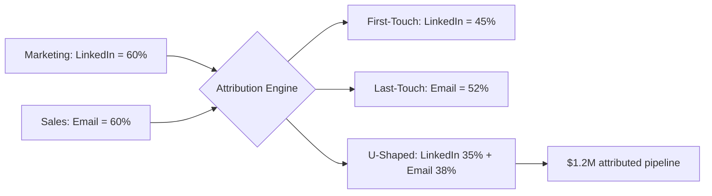
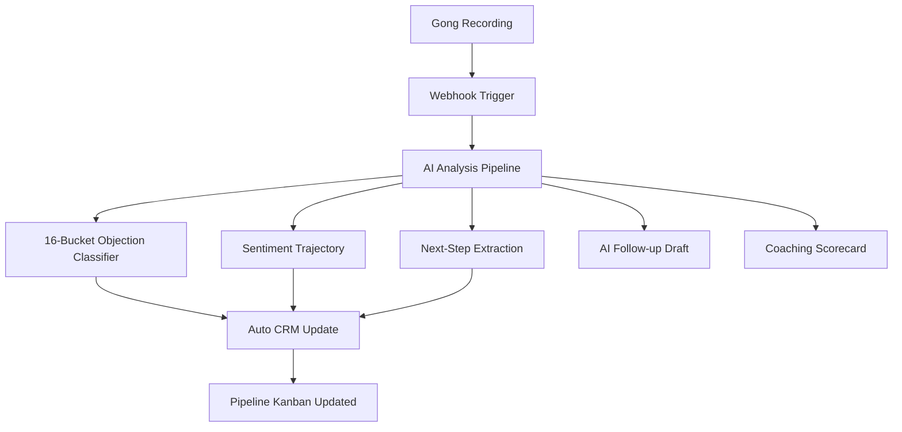
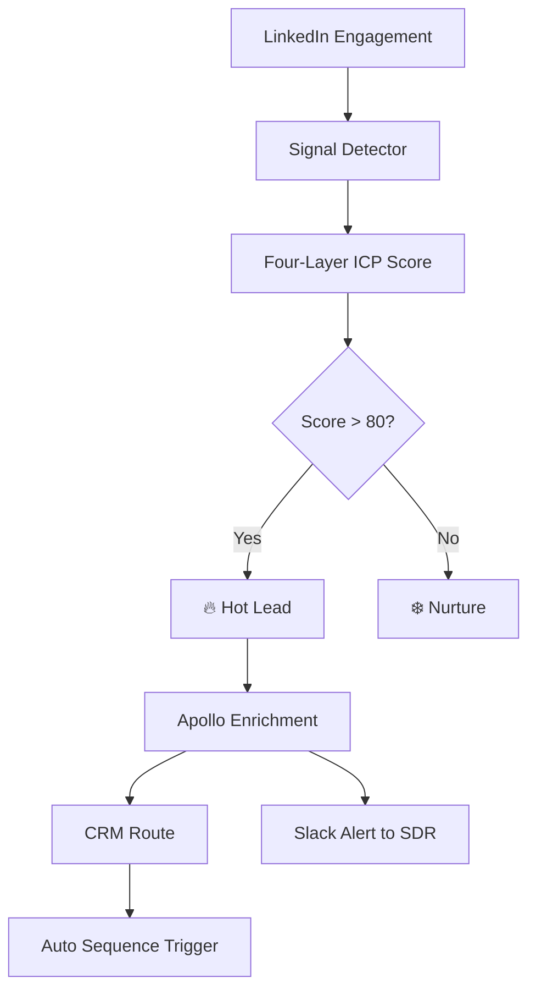
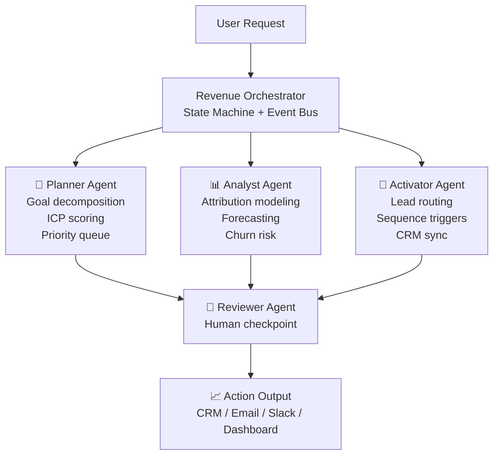
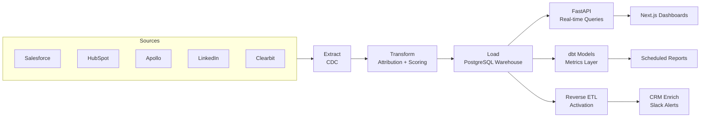
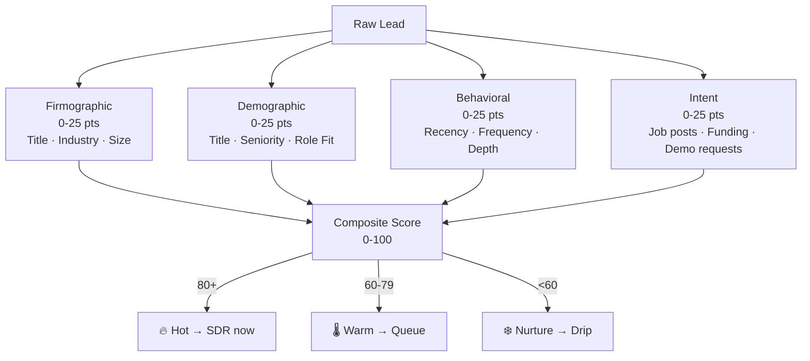
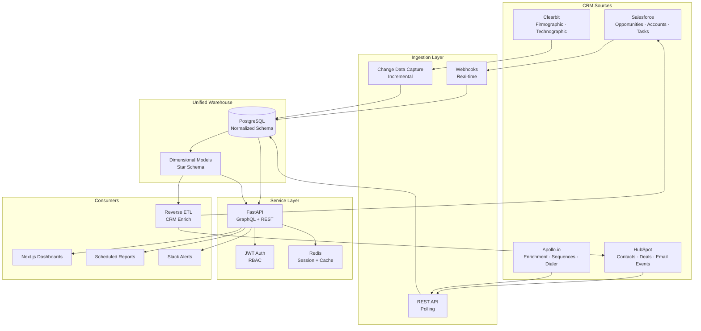
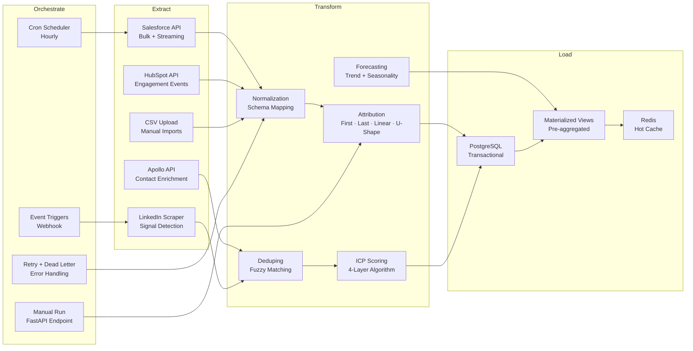
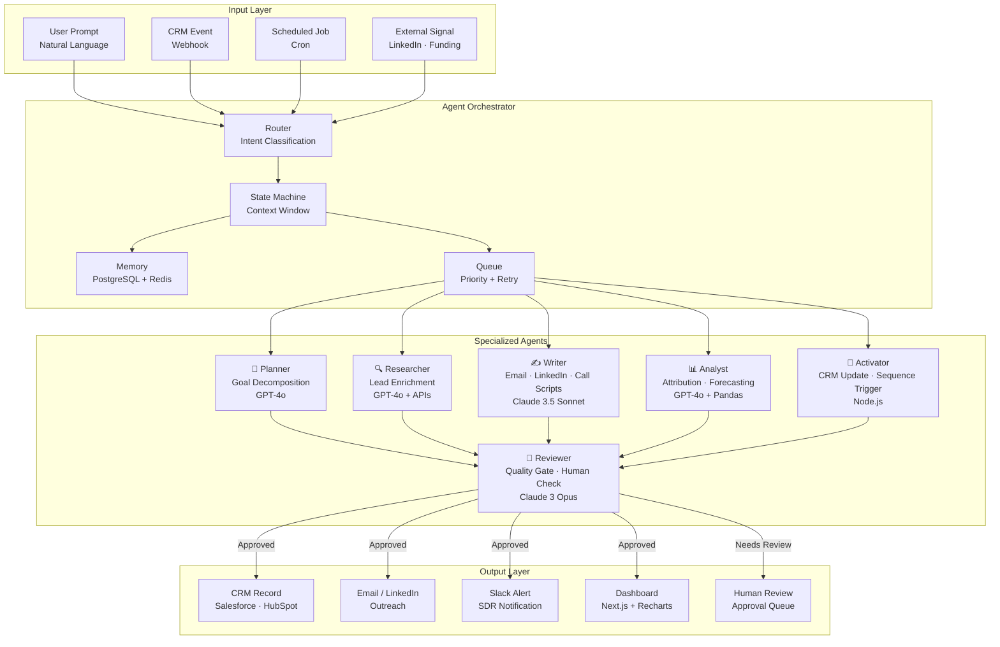

<h1 align="center">
  
</h1>

  <b>7 YOE: Built production web apps as a Software Engineer. Now building agentic GTM infrastructure as a GTM Engineer.</b> 
  US Citizen · Remote · 2-Week Notice · Open to Full-Time & Contract

  
  
  
  
  

  
  
  

---

## ✨ TL;DR

I build **AI-native full-stack systems** that move revenue metrics. 7 years as a Software Engineer shipping **Next.js/React**, **TypeScript/Node.js APIs**, and **PostgreSQL** data layers — from fintech (SoFi, Ally Bank) to government/defense (General Dynamics IT). Transitioned to GTM Engineering. Currently building **agentic GTM infrastructure**: lead scoring, multi-channel outreach, sales call intelligence, and autonomous pipeline management.

I ship with **Cursor**, **Claude Code & Codex**, and **GitHub Copilot** daily — using **GPT-4o**, **GPT-4o-mini**, **Claude 3.5 Sonnet**, and **Claude 3 Opus** to accelerate architecture, not replace judgment.

---

## 🛠️ Tech Stack

  
  
  
  
  
  
  
  
  
  
  
  
  
  
  
  
  
  
  

---

## 📚 Selected Work

  

---

### $1.2M Pipeline Attribution Clarity

A Series B SaaS startup was burning $40K/month on paid acquisition with no visibility into which channels produced pipeline. I built a **multi-touch attribution warehouse** that ingested every touchpoint from Salesforce, HubSpot, Apollo, and Clearbit into a unified PostgreSQL schema. Four attribution models run in parallel — first-touch, last-touch, linear, and U-shaped.

  
  
  

U-shaped attribution revealed LinkedIn created awareness (35%) but email closed deals (38%). Budget reallocated from broad LinkedIn ads to targeted email nurture. CFO moved from asking "Is this working?" to "How do we scale what works?"

---

### 5.2 Hours/Week Reclaimed Per Sales Rep

An enterprise team of 12 reps spent **6.4 hours/week** on post-call admin: CRM updates, follow-up emails, call notes. CRM adoption was 34%. I built an **AI-native sales pipeline** integrating with Gong, Fathom, and Fireflies to auto-analyze every call.

  
  
  

Post-call admin dropped from 6.4 hrs to 1.2 hrs per rep. CRM adoption jumped to 89% because records updated automatically — reps only reviewed and approved. Follow-up send time went from 45 minutes to 3 minutes. Rep coaching became data-driven: managers saw exactly which objection types each rep struggled with.

---

### 4x Meeting Book Rate from Signal Detection

An outbound SDR team worked from static ZoomInfo lists with 30-45 day stale intent data. Meeting book rate: **2.1%**. I built a **real-time signal detection system** monitoring LinkedIn public engagement against competitor watchlists.

  
  
  

Meeting book rate jumped from 2.1% to 8.7%. Lead response time went from 30-45 days to under 15 minutes. Daily dials dropped from 80 to 35, but meetings booked per week increased from 3.2 to 6.1. Competitive win rate improved 23% because reps reached prospects during active evaluation windows.

---

## 🏗️ Architecture

### Multi-Agent Revenue Orchestration

### Lead-to-Revenue Data Pipeline

### Four-Layer ICP Scoring

### CRM Architecture

### Data Pipeline Architecture

### AI Agent Architecture

---

## 🚀 Featured Projects

  

<table>
  <tr>
    <td width="50%">
      <h3>🏦 <a href="https://github.com/developers-universe-1/agentic-revenue-intelligence">Agentic Revenue Intelligence</a></h3>
      
Revenue attribution engine, four-layer ICP scoring, lead-to-revenue analytics, CRM data sync.

      
<strong>Python · FastAPI · PostgreSQL · Pandas · SQLAlchemy · Salesforce API</strong>

    </td>
    <td width="50%">
      <h3>🎯 <a href="https://github.com/developers-universe-1/agentic-demand-engine">Agentic Demand Engine</a></h3>
      
LinkedIn signal detection → ICP scoring → enrichment → CRM routing.

      
<strong>Next.js 15 · TypeScript · PostgreSQL · Prisma · GPT-4o</strong>

    </td>
  </tr>
  <tr>
    <td width="50%">
      <h3>📢 <a href="https://github.com/developers-universe-1/agentic-outreach-engine">Agentic Outreach Engine</a> <a href="https://agentic-outreach-engine-cuppoyw73-madelyn-lagares-projects.vercel.app/">🌐</a></h3>
      
Multi-channel sequences with reply classification, auto-tuning, A/B testing.

      
<strong>Next.js 15 · TypeScript · Recharts · Node.js</strong>

    </td>
    <td width="50%">
      <h3>💼 <a href="https://github.com/developers-universe-1/agentic-sales-engine">Agentic Sales Engine</a></h3>
      
Call intelligence, auto-pipeline kanban, AI follow-ups, rep coaching.

      
<strong>Next.js 15 · TypeScript · Prisma · GPT-4o · SSE streaming</strong>

    </td>
  </tr>
</table>

---

## 🤖 How I Ship

**Daily stack:** Cursor (IDE) · Claude Code & Codex (refactors) · GitHub Copilot (boilerplate)  
**Models:** GPT-4o · GPT-4o-mini · Claude 3.5 Sonnet · Claude 3 Opus · OpenRouter

**Workflow:** Natural language spec → AI-accelerated implementation → human-owned architecture, error handling, and production reliability.

---

## 🌱 Open Source Contributions

I contribute to tools at the intersection of AI, revenue systems, and developer infrastructure.

### AI Sales & GTM Tools

| Project | Why It Matters | Contribution Angle |
|---------|---------------|-------------------|
| **[SalesGPT](https://github.com/filip-michalsky/SalesGPT)** | Context-aware AI sales agent using LangChain. 1.8k+ stars. Built for autonomous outreach. | Add multi-channel sequence support (email → LinkedIn → call), improve objection handling memory |
| **[CrewAI](https://github.com/joaomdmoura/crewai)** | Multi-agent orchestration framework. Role-based agents ideal for sales teams (researcher → copywriter → reviewer). | Build a "Revenue Crew" template: planner, researcher, outreach writer, and deal analyst agents |
| **[Bricks](https://github.com/BraaMohammed/bricks)** | Open-source Clay.com alternative. AI agents + web scraping + Puppeteer for lead enrichment. | Add Apollo.io/Clearbit connector nodes, build ICP scoring pipeline |
| **[Twenty CRM](https://github.com/twentyhq/twenty)** | Open-source CRM for modern revenue teams. TypeScript + NestJS + PostgreSQL. | Frontend components, API integrations, activity timeline features |

### Developer Infrastructure

| Project | Why It Matters | Contribution Angle |
|---------|---------------|-------------------|
| **[LangChain](https://github.com/langchain-ai/langchain)** | The standard framework for LLM applications. Powers every AI system I build. | Add structured output examples for sales use cases, Zod schema patterns |
| **[n8n](https://github.com/n8n-io/n8n)** | Workflow automation platform. Core infrastructure for RevOps data pipelines. | Build CRM/data enrichment nodes (Apollo, Clearbit, ZoomInfo) |

> **Want to collaborate?** I'm always looking for interesting open-source projects at the intersection of AI, revenue systems, and developer tools.

## 💼 Looking For

- **GTM Engineer** — Revenue tech stack, AI agents, sales ops automation
- **Software Engineer** — Full-stack, AI-adjacent, early-stage
- **Founding Engineer** — 0→1 product ownership

**Must-haves:** Remote-first, US-based, small high-velocity team  
**Comp:** $150k–$210k base, flexible on equity  
**Start:** 2-week notice

---

## 📬 Contact

  
  
  

  <b>📧 madelynreyes2026@gmail.com</b> 
  <b>🌐 United States (Remote) · US Citizen · No sponsorship needed</b>

