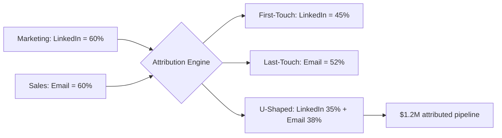
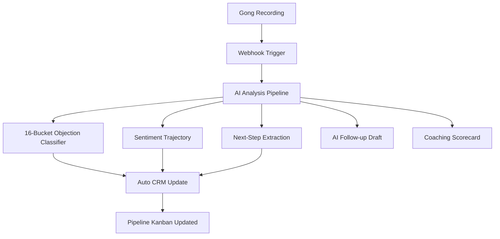
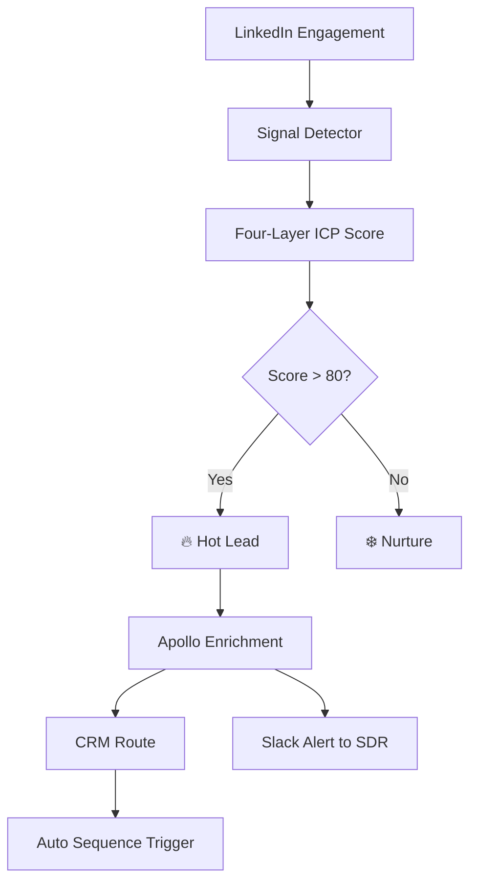
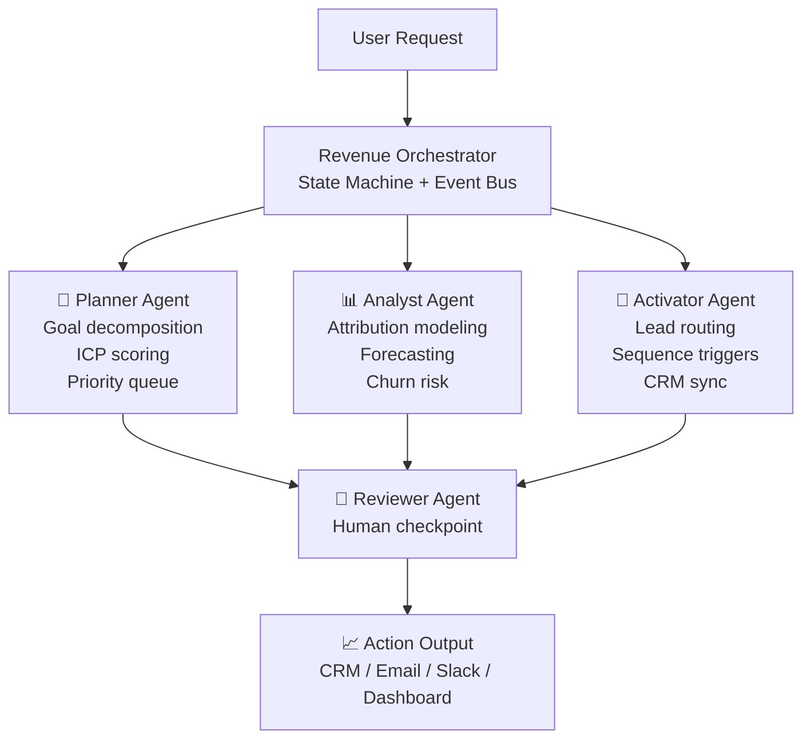
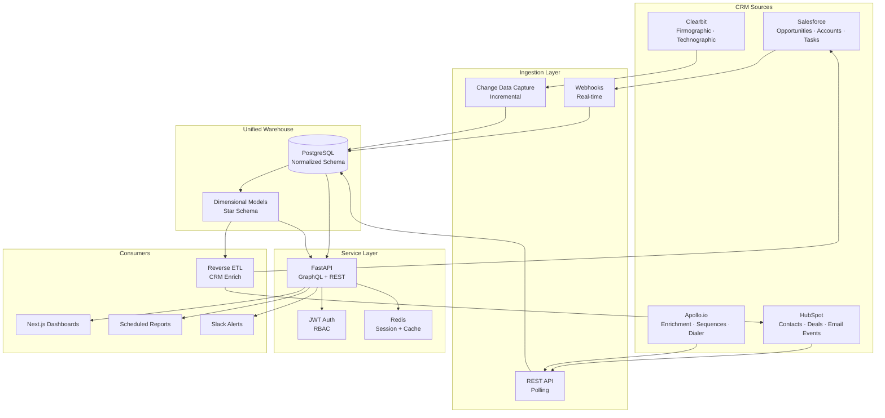
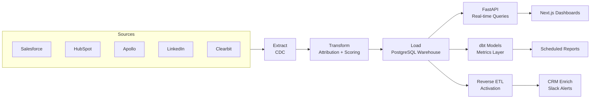

<h1 align="center">
  
</h1>

  <b>I build and deploy AI-powered software directly with customers — from discovery to production.</b> 
  US Citizen · Washington DC-Baltimore Area · Remote · 2-Week Notice · Open to Full-Time & Contract

  
  
  
  
  

  
  
  

---

## ✨ TL;DR

I'm a **Forward Deployed Engineer**: I embed with customers, map their workflows, and ship production software that solves them. 7 years as a Software Engineer shipping **TypeScript/React/Next.js**, **Python/FastAPI/Node.js**, and **PostgreSQL** — from fintech (SoFi, Ally) to government/defense (General Dynamics IT). Now at CalendarFuel, I design and deploy **AI-enabled applications, LLM agents, and integration architecture** for real customer environments.

**Currently in production:** ~50 customers and campaigns across 10 companies · 20–30 active LinkedIn profiles operated for internal sales teams · workflows processing up to **500K prospects/records per month** · ~1 week faster time-to-close through automated research, personalized outreach, and sales intelligence.

I ship with **Cursor**, **Claude Code & Codex**, and **GitHub Copilot** daily — using **GPT-4o**, **GPT-4o-mini**, **Claude 3.5 Sonnet**, and **Claude 3 Opus** to accelerate architecture, not replace judgment.

---

## 💼 Experience

### Forward Deployed Engineer — CalendarFuel
*Jan 2025 – Present*

- Build and deploy production AI-powered software for a growing B2B SaaS company, working directly across engineering, product, sales, customers, and internal stakeholders.
- Translate customer workflows and business requirements into shipped features, prototypes, integrations, and production-ready solutions.
- Design integration architecture and data flows across CRM, enrichment, sequencing, communication, and internal systems — REST APIs, webhooks, async workflows, structured reporting.
- Build LLM-powered workflows, agents, dynamic personalization, and intelligent automation with TypeScript, React, Next.js, Python, and FastAPI.
- Support ~50 customers and campaigns across 10 companies, including client teams of 5–10 running active campaigns.
- Operate 20–30 active LinkedIn profiles for internal sales teams; support workflows processing up to 500,000 prospects/records per month.
- Cut time-to-close by ~1 week via faster data flow, personalized outreach, automated follow-up, and clearer sales intelligence.
- Own production troubleshooting, AI output evaluation, and customer feedback loops across the full SDLC.

### Software Engineer — SoFi
*Jan 2024 – Dec 2024 · Remote*

- Built Python (FastAPI) backend services and async data pipelines powering marketing and sales operations — ingesting, transforming, and syncing customer data between HubSpot, Salesforce, Dotdigital, and internal warehouses.
- Developed REST API connectors and webhook handlers keeping marketing automation and CRM in sync, so lead scoring, segmentation, and attribution data stayed accurate.
- Implemented validation, deduplication, and enrichment logic for clean records flowing into sales and marketing tools.
- Partnered with marketing ops and sales to debug sync issues, optimize API throughput, and build internal tooling for pipeline data health.
- Designed backend endpoints and aggregation jobs feeding campaign, conversion, and funnel metrics into leadership dashboards.

### Software Engineer — General Dynamics Information Technology
*Jan 2022 – Dec 2023 · West Palm Beach, FL*

- Developed secure full-stack web applications for federal government clients with Next.js, React, TypeScript, Node.js, and Python (FastAPI/Flask), meeting strict security compliance standards.
- Implemented RESTful and GraphQL APIs integrated with AWS services and relational databases — 99.9% uptime for mission-critical systems.
- Led code reviews and mentored junior developers; introduced automated testing with Jest and Cypress and CI/CD pipelines with GitHub Actions.
- Migrated monolithic systems to microservices architecture using Docker and Kubernetes.

### Software Developer Engineer in Test — Ally
*Jan 2019 – Dec 2021*

- Designed automated test suites for web applications using TypeScript, Cypress, and Playwright — E2E, integration, and regression coverage across front-end and back-end.
- Integrated automated testing into CI/CD pipelines, catching defects earlier and improving release reliability.

**Education:** Washington University of Science and Technology — Full-Stack Web Development Bootcamp (Cybersecurity, Software Engineering, Project Management)

---

## 🧭 FDE Portfolio

- [Decomposition Case Studies](fde-case-studies/README.md) — breaking down ambiguous customer problems into shipped systems
- [Production Incident Post-Mortem](post-mortems/ai-pipeline-rate-limit.md) — rate-limit failure in an AI pipeline, root cause to resolution
- [Production AI Evaluation](docs/production-ai-evaluation.md) — AI evals, latency budgets, and safety in production
- [Customer Reference Architecture](reference-architectures/ai-native-gtm-b2b-saas.md) — AI-native GTM architecture for B2B SaaS
- [SQL & Data Modeling Deep Dive](sql-showcase/README.md) — query patterns and schema design from production systems
- [GCP + Vertex AI RAG Agent](vertex-ai-rag-agent/README.md) — retrieval-augmented agent with evals, deployed on GCP

---

## 🛠️ Tech Stack

  
  
  
  
  
  
  
  
  
  
  
  
  
  
  
  
  
  
  
  
  
  
  

---

## 📚 Selected Work

  

---

### $1.2M Pipeline Attribution Clarity

**Customer problem:** A Series B SaaS client was burning $40K/month on paid acquisition with no visibility into which channels produced pipeline. **Deployed solution:** I designed and shipped a **multi-touch attribution warehouse** ingesting every touchpoint from Salesforce, HubSpot, Apollo, and Clearbit into a unified PostgreSQL schema. Four attribution models run in parallel — first-touch, last-touch, linear, and U-shaped.

  
  
  

U-shaped attribution revealed LinkedIn created awareness (35%) but email closed deals (38%). Budget reallocated from broad LinkedIn ads to targeted email nurture. CFO moved from asking "Is this working?" to "How do we scale what works?"

---

### 5.2 Hours/Week Reclaimed Per Sales Rep

**Customer problem:** An enterprise client team of 12 reps spent **6.4 hours/week** on post-call admin: CRM updates, follow-up emails, call notes. CRM adoption was 34%. **Deployed solution:** I built and deployed an **AI-native sales pipeline** integrating with Gong, Fathom, and Fireflies to auto-analyze every call.

  
  
  

Post-call admin dropped from 6.4 hrs to 1.2 hrs per rep. CRM adoption jumped to 89% because records updated automatically — reps only reviewed and approved. Follow-up send time went from 45 minutes to 3 minutes. Rep coaching became data-driven: managers saw exactly which objection types each rep struggled with.

---

### 4x Meeting Book Rate from Signal Detection

**Customer problem:** A client's outbound SDR team worked from static ZoomInfo lists with 30-45 day stale intent data. Meeting book rate: **2.1%**. **Deployed solution:** I built a **real-time signal detection system** monitoring LinkedIn public engagement against competitor watchlists.

  
  
  

Meeting book rate jumped from 2.1% to 8.7%. Lead response time went from 30-45 days to under 15 minutes. Daily dials dropped from 80 to 35, but meetings booked per week increased from 3.2 to 6.1. Competitive win rate improved 23% because reps reached prospects during active evaluation windows.

---

## 🏗️ Architecture

### Multi-Agent Revenue Orchestration

### Customer Integration Architecture

### Lead-to-Revenue Data Pipeline

---

## 🚀 Featured Projects

  

<table>
  <tr>
    <td width="50%">
      <h3>🏦 <a href="https://github.com/developers-universe-1/agentic-revenue-intelligence">Agentic Revenue Intelligence</a></h3>
      
Revenue attribution engine, four-layer ICP scoring, lead-to-revenue analytics, CRM data sync.

      
<strong>Python · FastAPI · PostgreSQL · Pandas · SQLAlchemy · Salesforce API</strong>

    </td>
    <td width="50%">
      <h3>🎯 <a href="https://github.com/developers-universe-1/agentic-demand-engine">Agentic Demand Engine</a></h3>
      
LinkedIn signal detection → ICP scoring → enrichment → CRM routing.

      
<strong>Next.js 15 · TypeScript · PostgreSQL · Prisma · GPT-4o</strong>

    </td>
  </tr>
  <tr>
    <td width="50%">
      <h3>📢 <a href="https://github.com/developers-universe-1/agentic-outreach-engine">Agentic Outreach Engine</a> <a href="https://agentic-outreach-engine-cuppoyw73-madelyn-lagares-projects.vercel.app/">🌐</a></h3>
      
Multi-channel sequences with reply classification, auto-tuning, A/B testing.

      
<strong>Next.js 15 · TypeScript · Recharts · Node.js</strong>

    </td>
    <td width="50%">
      <h3>💼 <a href="https://github.com/developers-universe-1/agentic-sales-engine">Agentic Sales Engine</a></h3>
      
Call intelligence, auto-pipeline kanban, AI follow-ups, rep coaching.

      
<strong>Next.js 15 · TypeScript · Prisma · GPT-4o · SSE streaming</strong>

    </td>
  </tr>
</table>

---

## 🤖 How I Ship

**Daily stack:** Cursor (IDE) · Claude Code & Codex (refactors) · GitHub Copilot (boilerplate)  
**Models:** GPT-4o · GPT-4o-mini · Claude 3.5 Sonnet · Claude 3 Opus · OpenRouter

**Workflow:** Customer discovery → natural language spec → AI-accelerated implementation → human-owned architecture, error handling, and production reliability.

I deploy on GCP, AWS, and Vercel — infrastructure decisions are driven by customer constraints, not preference.

---

## 🌱 Open Source Contributions

Active contributor to developer infrastructure and AI tooling at scale. I ship bug fixes, documentation improvements, and quality-of-life updates across the projects I use in production every day.

### Where I've Contributed

| Project | Why It Matters | Focus Areas |
|---------|---------------|-------------|
| **[PostHog](https://github.com/PostHog/posthog)** | Product analytics + feature flags. The open-source alternative to Mixpanel/Amplitude. | Frontend fixes, AI prompt template corrections, test descriptions |
| **[n8n](https://github.com/n8n-io/n8n)** | Workflow automation platform. Core infrastructure for RevOps data pipelines. | UI text fixes and documentation improvements across node definitions |
| **[CrewAI](https://github.com/joaomdmoura/crewai)** | Multi-agent orchestration framework. Role-based agents for sales & ops teams. | Tooling fixes and error message corrections |
| **[Cal.com](https://github.com/calcom/cal.com)** | Open-source scheduling infrastructure. TypeScript + Next.js + PostgreSQL. | i18n string corrections and TypeScript utility fixes |
| **[hermes-agent](https://github.com/NousResearch/hermes-agent)** | Open-source AI agent framework. Python gateway, event hooks, error classification, MCP config. | Bug fixes in hook registry, error classifier, and CLI arg parsing |

**Recent PRs:**
- PostHog: [#60409](https://github.com/PostHog/posthog/pull/60409) · [#60411](https://github.com/PostHog/posthog/pull/60411)
- n8n: [#31272](https://github.com/n8n-io/n8n/pull/31272) · [#31275](https://github.com/n8n-io/n8n/pull/31275)
- CrewAI: [#5960](https://github.com/crewAIInc/crewAI/pull/5960)
- Cal.com: [#29477](https://github.com/calcom/cal.diy/pull/29477) · [#29478](https://github.com/calcom/cal.diy/pull/29478)
- hermes-agent: [#37486](https://github.com/NousResearch/hermes-agent/pull/37486) · [#37526](https://github.com/NousResearch/hermes-agent/pull/37526) · [#37531](https://github.com/NousResearch/hermes-agent/pull/37531)

### Ecosystem I Follow

| Project | Why It Matters |
|---------|---------------|
| **[SalesGPT](https://github.com/filip-michalsky/SalesGPT)** | Context-aware AI sales agent using LangChain. 1.8k+ stars. Built for autonomous outreach. |
| **[Bricks](https://github.com/BraaMohammed/bricks)** | Open-source Clay.com alternative. AI agents + web scraping for lead enrichment. |
| **[Twenty CRM](https://github.com/twentyhq/twenty)** | Open-source CRM for modern revenue teams. TypeScript + NestJS + PostgreSQL. |
| **[LangChain](https://github.com/langchain-ai/langchain)** | The standard framework for LLM applications. Powers every AI system I build. |

> **Want to collaborate?** I'm always looking for interesting open-source projects at the intersection of AI, customer-facing systems, and developer tools.

## 💼 Looking For

- **Forward Deployed Engineer** — embedded with customers, shipping AI-native systems from discovery to production
- **Customer Engineer** — owning the technical relationship across integration, deployment, and adoption
- **Solutions Engineer** — AI-native systems: technical architecture, integrations, pre/post-sales engineering

**Must-haves:** Remote-first, US-based, small high-velocity team  
**Start:** 2-week notice

---

## 📬 Contact

  
  
  

  <b>📧 madelynreyes2026@gmail.com</b> 
  <b>🌐 Washington DC-Baltimore Area (Remote) · US Citizen · No sponsorship needed</b>

