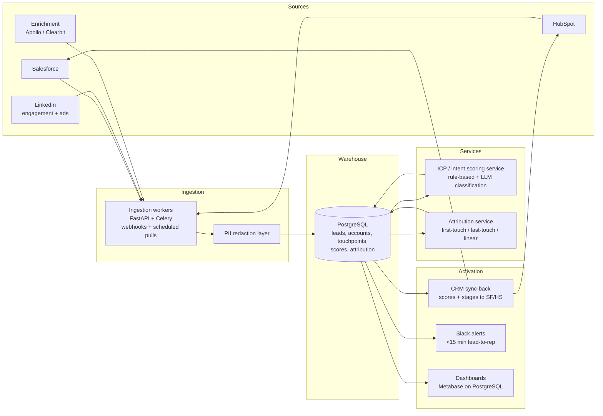

# Reference Architecture: AI-Native GTM for B2B SaaS

A production reference architecture for unifying lead intelligence, intent scoring, and attribution across a B2B go-to-market stack. Designed to be deployed by one engineer against the customer's existing tools — no data team required.

## Customer Profile

This architecture targets B2B SaaS companies with 50–200 employees and a GTM stack of Salesforce (system of record), HubSpot (marketing automation), and LinkedIn (paid + organic outbound). Typical profile:

- 5–20 SDRs/AEs, a RevOps lead doing double duty as "the data person"
- No dedicated data team, no warehouse, no analytics engineer
- Enrichment subscriptions (Apollo, Clearbit, or similar) that sync on schedules nobody audits
- Meeting book rate stuck at 1–3% because scoring is a static list, not a signal pipeline

The constraint that shapes every decision below: the stack must be operable by RevOps alone after handoff. Anything that requires on-call data engineering is out of scope.

## Architecture

Design notes:

- **PostgreSQL is the warehouse, deliberately.** At 50–200 employees, GTM data is ~100K–1M records/month. Postgres handles this with room to spare, and the RevOps lead already knows enough SQL to debug it. See Alternatives Considered.
- **Scoring is two-layer.** A deterministic rule layer (firmographic fit, title match, technographics) runs in SQL. An LLM layer classifies unstructured signals (LinkedIn post content, email replies, call transcripts). The LLM never sees raw PII — the redaction layer sits in front of it.
- **Sub-15-minute lead-to-alert latency** comes from webhook-first ingestion. Scheduled pulls (hourly) are the fallback for sources without webhooks.
- **Sync-back is the moat.** Scores and stage changes write back into Salesforce/HubSpot so reps never leave their CRM. Adoption dies the day you ask a rep to check a second tool.

## Deployment Guide

1. **Provision infrastructure.** Single Docker host or Cloud Run/ECS: FastAPI ingestion service, Celery workers, Redis, PostgreSQL 15+ (RDS/Cloud SQL with automated backups). Terraform module provided; ~30 minutes to a running stack. Budget guidance: this fits in ~$150–300/month of managed infra.
2. **Connect CRMs via OAuth.** Register connected apps in Salesforce and HubSpot with least-privilege scopes (read leads/contacts/accounts/opportunities, write to custom score fields only). OAuth 2.0 authorization-code flow; tokens stored encrypted at rest, refresh handled by the platform. Never API keys pasted into a config file.
3. **Configure ICP scoring thresholds.** Start from the customer's last 90 days of closed-won deals: extract firmographic bands (headcount, industry, tech stack) and calibrate the rule layer against them. Set the Slack alert threshold so each rep gets 3–8 alerts/day, not 30 — alert fatigue kills the system faster than bad scoring.
4. **Enable alerting.** Wire Slack webhooks per territory/segment, plus a daily digest to the RevOps channel. Add a dead-letter alert: if ingestion fails for >2 hours, someone must know.
5. **First-week checklist.**
   - Day 1: verify record counts match CRM source-of-truth counts (±1%).
   - Day 2–3: shadow-mode scoring — scores computed and logged, nothing synced back. Compare against rep intuition on 20 known leads.
   - Day 4: enable CRM sync-back for one SDR pod, not the whole team.
   - Day 5: review alert volume; tune thresholds before expanding.
   - Day 7: retro with RevOps — what fired that shouldn't have, what didn't fire that should have.

## Security & Compliance

- **OAuth 2.0 for every CRM connection.** No stored passwords, no long-lived API keys for third-party systems. Tokens are encrypted at rest (KMS or equivalent) and scoped to minimum required permissions.
- **PII redaction before any LLM call.** Names, emails, phone numbers, and street addresses are tokenized before unstructured content is sent to a model; the token map never leaves the customer's infrastructure. Model providers are used under zero-retention API agreements.
- **Audit log retention: 1 year.** Every score change, CRM write-back, and data-access event is logged with actor, timestamp, and before/after values. Retained 12 months, then purged.
- **Least-privilege service accounts.** Each integration gets its own service account with narrowly scoped permissions; no shared admin credentials anywhere in the stack.
- **Data residency.** All customer data stays in the customer's cloud account (or a dedicated single-tenant deployment). Nothing is co-mingled across customers.

## Scaling Notes (at 10x volume)

At ~10M records/month, three things change and the rest doesn't:

- **PostgreSQL needs partitioning and read replicas.** Partition touchpoint/event tables by month; move dashboards to a read replica so analytics never contends with sync-back writes. Still not a Snowflake problem yet.
- **Ingestion moves from scheduled pulls to event-driven.** Webhook coverage becomes mandatory; Celery workers autoscale on queue depth. Backfills go through a separate bulk path so they never starve real-time alerts.
- **Scoring moves from per-event to micro-batch.** Score in 5-minute windows instead of per record; LLM classification gets a batch API and caching layer (most enrichment content repeats).

What does *not* change: the mermaid diagram above is identical. The seams (ingestion → warehouse → scoring → activation) are the right seams; the components behind them scale independently.

## Alternatives Considered

**Snowflake vs PostgreSQL.** Snowflake is the right answer at 10M+ records/month with an analytics engineer to run it. For this customer profile it adds cost (~$1–2K/month floor), a second query dialect for RevOps to learn, and an ops burden they can't staff. PostgreSQL wins until partitioning stops being enough — and the migration path (pg_dump → Snowflake, or CDC via Fivetran) is well-trodden when that day comes.

**dbt vs SQL models.** dbt earns its keep when there are 50+ models and multiple contributors. Here there are ~10 scoring/attribution models maintained by one person; version-controlled SQL files with a light runner are simpler and have zero new-tool overhead. If a data hire ever joins, the SQL ports into dbt in a day — it's already modular.

**Build vs buy vs Clay.** Clay is a strong product for list-building and enrichment waterfalls, and for teams under ~5 reps it's the right call. It breaks down as the system of record for *attribution and closed-loop scoring*: custom multi-touch models, write-back orchestration, and per-customer calibration live awkwardly or not at all inside it. The build path here is deliberately narrow (~2 weeks of engineering to v1) because the wedge is scoring + alerting, not a platform. Buy the commodity parts (enrichment, dashboards), build the parts that encode the customer's specific GTM motion.
