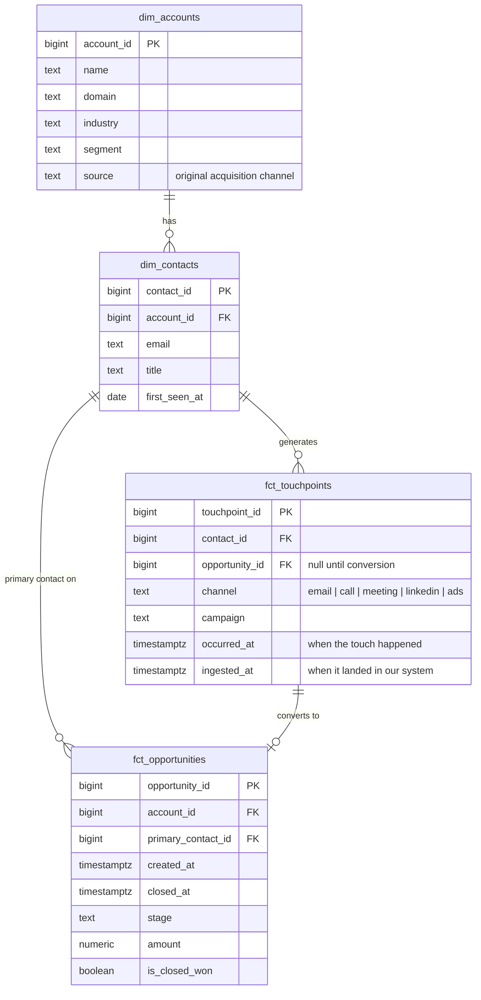

# SQL Showcase: GTM Analytics in PostgreSQL

The GTM systems I've built (lead intelligence, outreach sequencing, call analysis over Salesforce/HubSpot/Apollo data) all answer the same class of question: *which touches produced which revenue, and what did we know when?* This file is the SQL core of that work — a minimal star schema, production-grade attribution queries, and the two correctness problems that quietly break most GTM reporting.

Deliberately plain PostgreSQL. No dbt, no warehouse-specific features — at the company sizes I work with (~50 customers, ~500K records/month), the queries below run fine on a single Postgres instance and the ops simplicity is worth more than warehouse scale.

## Star Schema

Two dimensions, two facts. `fct_touchpoints` is the workhorse — one row per tracked interaction (email open, call, meeting, ad click), stamped with when it happened *and* when we learned about it. That second timestamp matters; see Hard Problems.



Key modeling choice: `touchpoint_id` on opportunities' pre-conversion touches stays `NULL` until conversion, then gets backfilled. Attribution joins happen at query time, not write time — the alternative (resolving touches to opportunities in the ingestion pipeline) bakes today's join logic into historical data and makes model changes a backfill project.

## Multi-Touch Attribution

Three models in one query set. First-touch and last-touch are naive but stakeholders ask for them; U-shaped (40/40/20) is what we actually used for budget decisions because it credits both demand creation and demand capture without the false precision of algorithmic models on ~500K records/month of data.

```sql
-- Every touch attributable to an opportunity, in order. Restricting to
-- touches BEFORE created_at is the entire ballgame: a touch that happens
-- after the opportunity exists is sales activity, not sourcing.
WITH eligible AS (
    SELECT
        t.opportunity_id,
        t.touchpoint_id,
        t.channel,
        t.occurred_at,
        ROW_NUMBER() OVER (
            PARTITION BY t.opportunity_id ORDER BY t.occurred_at
        ) AS rn,
        COUNT(*) OVER (PARTITION BY t.opportunity_id) AS n_touches,
        -- The "opportunity creation" touch for U-shaped: the LAST touch
        -- before conversion, not the first. First touch and creation touch
        -- coincide only when n_touches = 1.
        MAX(t.occurred_at) OVER (PARTITION BY t.opportunity_id) AS creation_touch_at
    FROM fct_touchpoints t
    JOIN fct_opportunities o USING (opportunity_id)
    WHERE t.opportunity_id IS NOT NULL
      AND t.occurred_at < o.created_at
),
weights AS (
    SELECT
        opportunity_id,
        touchpoint_id,
        -- First-touch: 100% to the earliest touch.
        CASE WHEN rn = 1 THEN 1.0 ELSE 0 END AS w_first,
        -- Last-touch: 100% to the touch nearest opportunity creation.
        CASE WHEN occurred_at = creation_touch_at THEN 1.0 ELSE 0 END AS w_last,
        -- U-shaped: 40% first, 40% creation touch, 20% split across the
        -- middle. Single-touch opportunities get 100% on that touch;
        -- two-touch opportunities split 50/50 (first and creation coincide
        -- with the two touches, so 40/40 collapses cleanly).
        CASE
            WHEN n_touches = 1 THEN 1.0
            WHEN n_touches = 2 THEN 0.5
            WHEN rn = 1 OR occurred_at = creation_touch_at THEN 0.4
            ELSE 0.2 / (n_touches - 2)
        END AS w_u
    FROM eligible
)
SELECT
    e.channel,
    ROUND(SUM(w.w_first * o.amount), 2) AS pipeline_first_touch,
    ROUND(SUM(w.w_last  * o.amount), 2) AS pipeline_last_touch,
    ROUND(SUM(w.w_u     * o.amount), 2) AS pipeline_u_shaped
FROM weights w
JOIN eligible e USING (opportunity_id, touchpoint_id)
JOIN fct_opportunities o USING (opportunity_id)
GROUP BY e.channel
ORDER BY pipeline_u_shaped DESC;
```

Swap `o.amount` for `CASE WHEN o.is_closed_won THEN o.amount ELSE 0 END` to get sourced revenue instead of pipeline. I report both — pipeline attribution moves within weeks and is useful for channel tuning; revenue attribution lags by the sales cycle but is the only number finance trusts.

## Monthly Cohort Conversion

"Of the contacts we first saw in month M, what fraction became opportunities, and how fast?" Cohort by `first_seen_at` rather than by campaign — campaigns overlap and re-target, so campaign-level conversion double-counts; contact-level cohorts don't.

```sql
WITH cohorts AS (
    SELECT
        date_trunc('month', first_seen_at) AS cohort_month,
        contact_id
    FROM dim_contacts
),
conversions AS (
    SELECT
        c.cohort_month,
        c.contact_id,
        MIN(o.created_at) AS first_opp_at  -- first conversion only;
                                           -- later opps are expansion, not cohort conversion
    FROM cohorts c
    JOIN fct_opportunities o ON o.primary_contact_id = c.contact_id
    GROUP BY 1, 2
)
SELECT
    c.cohort_month,
    COUNT(*) AS cohort_size,
    COUNT(v.first_opp_at) AS converted,
    ROUND(100.0 * COUNT(v.first_opp_at) / COUNT(*), 1) AS conversion_pct,
    -- Median days-to-convert beats the mean here: the distribution is
    -- right-skewed (a few contacts convert a year later) and the mean
    -- overstates typical performance.
    ROUND(EXTRACT(EPOCH FROM
        percentile_cont(0.5) WITHIN GROUP (ORDER BY v.first_opp_at - c.cohort_month)
    ) / 86400, 1) AS median_days_to_opp
FROM cohorts c
LEFT JOIN conversions v USING (cohort_month, contact_id)
GROUP BY 1
ORDER BY 1;
```

Recent cohorts will under-read — a contact from last month hasn't had time to convert. I flag the last 2–3 cohorts as "maturing" wherever this gets displayed, or cut the analysis at `first_seen_at < now() - interval '90 days'` for a comparable-cohorts view.

## Hard Problems

### Point-in-time correctness ("what did we know as of date X?")

GTM data mutates: a lead's title changes, an account re-segments from SMB to mid-market, a score gets recomputed. If you train a scoring model or run a retro analysis against *current* dimension values, you leak the future into the past — the model "learns" that leads who converted had titles we only learned about after they converted. That's how you ship a scorer that looks great in backtest and does nothing in production.

The fix is an effective-dated snapshot table for anything that can change, and a hard rule: every historical query joins `as_of` against the snapshot, never against the live dimension.

```sql
-- contact_snapshots: one row per (contact_id, valid_from) per change.
-- valid_to is the exclusive upper bound; NULL means "still current."
SELECT s.contact_id, s.title, s.icp_score
FROM contact_snapshots s
WHERE s.contact_id = 41782
  AND s.valid_from <= '2026-03-15'::timestamptz
  AND (s.valid_to IS NULL OR s.valid_to > '2026-03-15'::timestamptz);
```

Cheap to maintain (a trigger or an ingestion-time diff writes new snapshot rows), and it makes "as of X" a join condition instead of an archaeology project. The failure mode I see most often isn't missing snapshots — it's one analyst query joining the live table "just this once" and the resulting number making it into a deck.

### Late-arriving touchpoints

Touchpoints don't arrive in order. Salesforce activities sync hourly, ad platform data lands a day late, a rep logs a call from last Tuesday on Friday. If attribution runs are pure append-only aggregations, yesterday's numbers silently change and nobody trusts the dashboard.

Two rules handle it:

1. **Attribute by `occurred_at`, never `ingested_at`.** The attribution queries above already do this — a touch that lands late still slots into its true position in the sequence.
2. **Recompute windows, don't append.** Attribution over the last N days is cheap; recompute it wholesale on each run so late arrivals update history instead of being dropped or double-counted.

For cases where you need stable *and* correct numbers (e.g., a monthly report that can't retroactively change), freeze with an explicit watermark:

```sql
-- Only touches we knew about by the reporting cutoff. Deterministic
-- given the cutoff; rerunning the report later returns identical numbers.
SELECT *
FROM fct_touchpoints
WHERE occurred_at < '2026-08-01'
  AND ingested_at < '2026-08-05 00:00'::timestamptz;  -- cutoff, not "now"
```

The tradeoff is explicit: watermark reports are reproducible but permanently blind to anything that arrived after the cutoff; recomputed reports are correct but history moves. I use recomputed for operational dashboards and watermarks for anything that goes to a board deck — and I say which one a number is whenever I hand it to someone.
