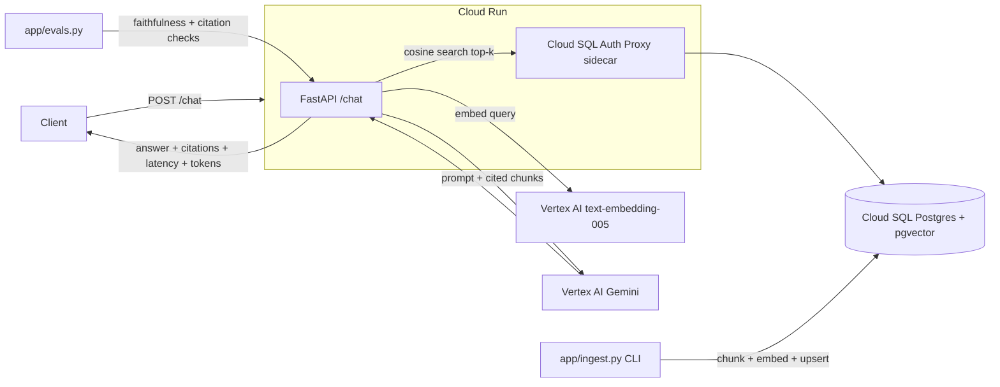

# vertex-ai-rag-agent

A customer support RAG agent on Google Cloud: FastAPI service, Vertex AI Gemini for
generation, Vertex AI text embeddings, and Cloud SQL for Postgres with pgvector as the
vector store. Deploys to Cloud Run.

Scope is deliberately small. The goal is a production-*shaped* MVP: real retrieval,
real latency/token accounting, an eval harness, and boring operational choices that
scale beyond the demo.

## Architecture



Request flow: the question is embedded, the top-k chunks are fetched from pgvector by
cosine distance, a grounded prompt with numbered sources is built, Gemini answers with
inline `[n]` citations, and the response includes per-stage latency, token usage, and
a `trace_id` keyed to the audit trail (see Audit Trail).

## Setup

### 1. Enable APIs and create the database

```bash
export PROJECT_ID=your-project REGION=us-central1
gcloud config set project $PROJECT_ID

gcloud services enable run.googleapis.com cloudbuild.googleapis.com \
  sqladmin.googleapis.com aiplatform.googleapis.com secretmanager.googleapis.com

# Cloud SQL Postgres 16, smallest tier that carries pgvector comfortably.
gcloud sql instances create rag-pg \
  --database-version=POSTGRES_16 --tier=db-custom-2-4096 --region=$REGION

gcloud sql databases create rag --instance=rag-pg
gcloud sql users create rag-app --instance=rag-pg --password="$(openssl rand -base64 24)"

# Store the password in Secret Manager; deploy.sh injects it from there.
printf '%s' 'YOUR_DB_PASSWORD' | \
  gcloud secrets create rag-db-password --data-file=-
```

### 2. Ingest documents

Run locally (or in Cloud Shell) against the instance via the
[Cloud SQL Auth Proxy](https://cloud.google.com/sql/docs/postgres/sql-proxy):

```bash
cloud-sql-proxy $PROJECT_ID:$REGION:rag-pg &
python -m venv .venv && source .venv/bin/activate
pip install -r requirements.txt

export GCP_PROJECT=$PROJECT_ID GCP_REGION=$REGION DB_HOST=127.0.0.1 \
       DB_NAME=rag DB_USER=rag-app DB_PASSWORD=your-password

python -m app.ingest ./your_docs_folder --recreate
```

### 3. Deploy to Cloud Run

```bash
export GCP_PROJECT=$PROJECT_ID SQL_INSTANCE=$PROJECT_ID:$REGION:rag-pg
./deploy.sh
```

### 4. Use it

```bash
curl -X POST "$SERVICE_URL/chat" \
  -H 'Content-Type: application/json' \
  -d '{"question": "How do I rotate my API key without downtime?"}'
```

## Configuration

| Env var | Default | Purpose |
|---|---|---|
| `GCP_PROJECT` | — (required) | GCP project for Vertex AI |
| `GCP_REGION` | `us-central1` | Vertex AI / Cloud Run region |
| `GEMINI_MODEL` | `gemini-2.0-flash-001` | Generation model |
| `EMBEDDING_MODEL` | `text-embedding-005` | Embedding model |
| `DB_HOST` / `DB_PORT` | `127.0.0.1` / `5432` | Cloud SQL proxy sidecar address |
| `DB_NAME` / `DB_USER` | `rag` / `rag_app` | Database and user |
| `DB_PASSWORD` | — | Injected from Secret Manager |
| `TOP_K` | `5` | Chunks retrieved per question |
| `MAX_OUTPUT_TOKENS` | `512` | Hard cap on Gemini output (cost guardrail) |
| `TEMPERATURE` | `0.2` | Low, for grounded support answers |
| `CHUNK_SIZE` / `CHUNK_OVERLAP` | `1000` / `200` | Ingestion chunking (chars) |

## Evals

```bash
python -m app.evals evals/sample_questions.jsonl
```

Runs each question through the full pipeline and scores two things per answer:
faithfulness (Gemini-as-judge: is every claim supported by the retrieved chunks?) and
citation correctness (do all `[n]` markers point at actually-retrieved sources?).
Prints a pass rate. See `app/evals.py`.

## Audit Trail

Every `/chat` request writes one row to the `chat_traces` table (created at service
startup, `app/audit.py`). Each row captures what a reviewer needs to reconstruct a
decision: `trace_id` (also returned in the API response), status (`ok` /
`no_context`), SHA-256 hashes of the question and answer, model versions
(`gemini_model`, `embedding_model`), `prompt_version`, the retrieved sources with
scores, per-stage latency, token usage, and a deterministic `citations_ok` check
(every `[n]` maps to a retrieved chunk).

Questions and answers are stored as hashes, not text — the trace proves the pipeline
behaved without becoming a second copy of customer conversations. Trace writes are
best-effort: a tracing failure is logged, never surfaced as a request error.

```sql
-- "Show me every answer with a bad citation in the last 24h"
SELECT trace_id, created_at, sources, latency_ms
FROM chat_traces
WHERE citations_ok = false AND created_at > now() - interval '24 hours';
```

## Design Decisions

**Why pgvector instead of a dedicated vector DB (Vertex AI Vector Search, Pinecone, etc.)?**
The corpus here is support documentation — thousands to tens of thousands of chunks, not
millions. At that scale pgvector with an HNSW index is comfortably under the 300ms p95
retrieval budget, and it removes an entire managed service from the stack: one database
to back up, secure, and bill, with the metadata (`source`) living next to the vectors so
filters and citations need no cross-service join. Vector Search is the right call at
>1M vectors or when you need its serving SLOs; this MVP would pay its cost and
operational overhead for capacity it never uses. Migration path is clean: the
`documents` table is the only retrieval interface, so swapping stores touches `rag.py`
only.

**Why Cloud Run?** The workload is a stateless HTTP service with spiky, demo-to-peak
traffic. Cloud Run's scale-to-zero matches that: no idle cost, no node management, and
the Cloud SQL Auth Proxy sidecar pattern gives private, IAM-secured DB connectivity
without VPC plumbing beyond a connector. Concurrency 40 + max-instances 10 caps spend
by construction. **GKE is the alternative** if the service later needs WebSockets for
streaming, colocated GPU inference (e.g., a self-hosted reranker), or a shared service
mesh with neighboring internal services — the container and env contract here port
directly to a GKE Deployment.

**Why Gemini 2.0 Flash as default?** Support answers are short and citation-bound; Flash
hits the latency budget (see `docs/latency-and-cost.md`) at roughly 4–8x lower per-token
cost than Pro. The model is a single env var, so bumping to Pro for harder corpora is a
redeploy, not a code change.

**Why character-based chunking?** Predictable, dependency-free, and adequate for
well-structured support docs. Sentence/structure-aware chunking is a real improvement
but belongs behind eval evidence, not speculation — the harness exists to justify it.
